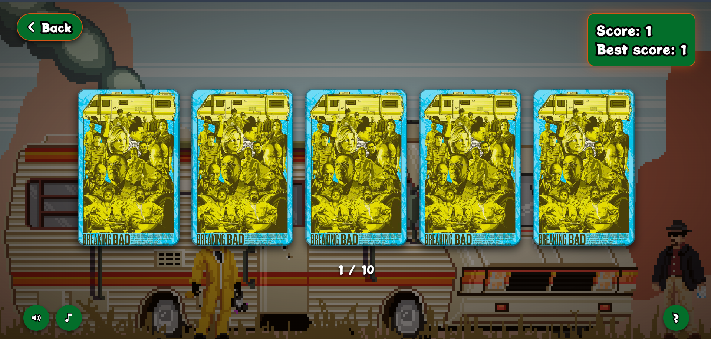

# Memory Card

A Breaking Bad–themed memory card game. Click characters to score — never click the same one twice. Cards reshuffle after every pick. Three difficulty levels, with sound effects and background music.

[Play it live](https://memory-card-w3nc.vercel.app/)

## How to play

1. Pick a level (Easy, Medium, Hard).
2. Click a card to reveal a character — that adds to your score.
3. Cards reshuffle and flip back down. Don't click a character you've already revealed.
4. Clear the whole pool to win; clicking a repeat loses the round.

## Tech

React + Vite. LocalStorage keeps your best score per level.

## Credits

- Background: [Matt Frith – Jesse: We Need to Pixel Some Sort of Breaking](https://www.mattfrith.com/post/54140644506/jesse-we-need-to-pixel-some-sort-of-breaking)
- Character photos: [Pinterest](https://www.pinterest.com/)
- Sound effects: [Pixabay](https://pixabay.com/)
