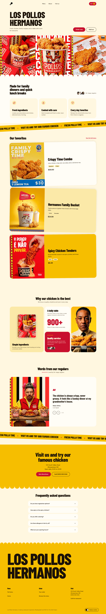
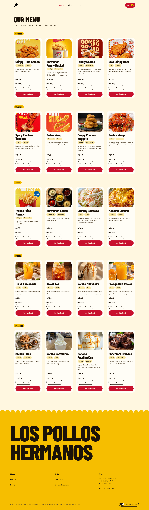
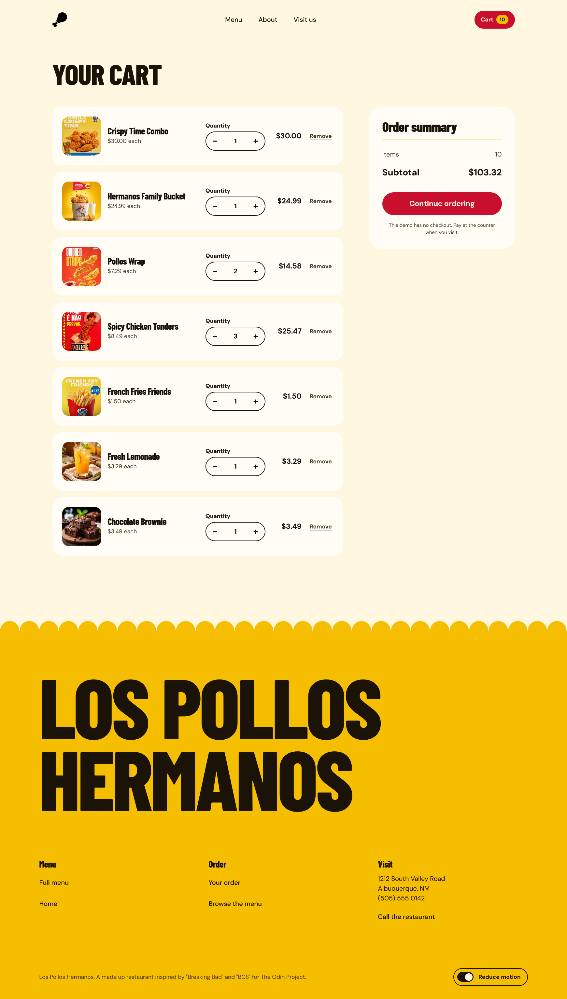

# Los Pollos Hermanos Shopping Cart

A React shopping cart app built with Vite, React Router, GSAP, and CSS Modules. Theme: Los Pollos Hermanos fried chicken restaurant.

## Live preview

https://shopping-cart-w3nc.vercel.app/

## Screenshots

Home page:


Cart page:


Cart with items:


## Tech stack

- React 19 with Vite
- React Router for navigation
- GSAP + ScrollTrigger for animations
- CSS Modules for styling
- Vitest + React Testing Library for tests

## Features

- Three pages: Home, Shop, Cart
- Navbar on every page with live cart item count
- Shop page lists menu items grouped by category (Combos, Chicken, Sides, Drinks, Desserts)
- Add items to cart with typed quantity input
- Cart page: view items, increase/decrease quantity, remove items
- Order summary with subtotal
- Fetch menu data asynchronously with loading and error states
- Respects reduced-motion preference via a site-wide toggle
- Deployed on Vercel with SPA redirect configuration

## Getting started

```bash
# Install dependencies
npm install

# Start dev server
npm run dev

# Build for production
npm run build

# Run tests
npm test

# Lint
npm run lint
```

## Project structure

```
src/
  pages/        Home, Shop, Cart, NotFound
  components/   Navbar, Footer, ProductCard, CartItem, Button, etc.
  context/      CartContext (cart state with useReducer)
  hook/         useMenu, useReducedMotion, useScrollTriggerRefresh
  utils/        currency formatting, motion control
  data/         menu photo mapping
  styles/       design tokens and global styles
public/
  menu.json     menu data source
  images/       menu images and favicon
```

## Attribution

Los Pollos Hermanos is a fictional restaurant from "Breaking Bad" and "Better Call Saul". This is a fan tribute project for The Odin Project shopping cart assignment, built with original assets only.